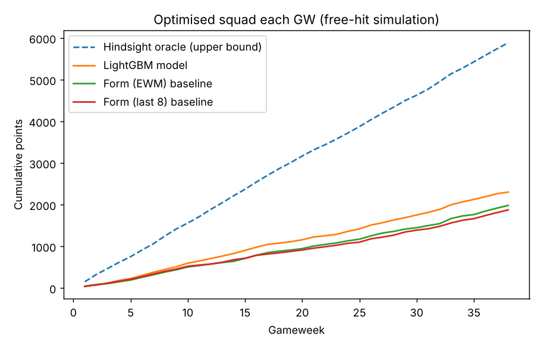
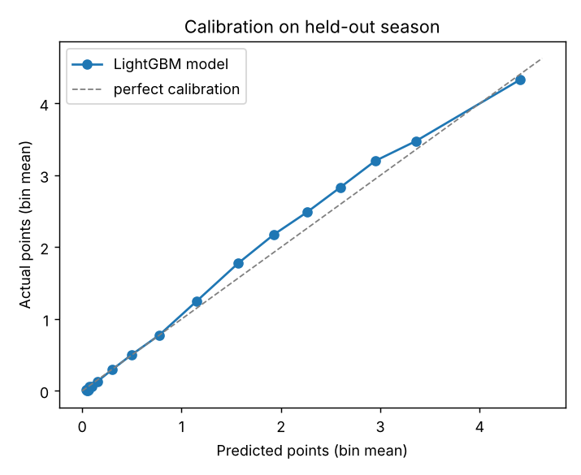
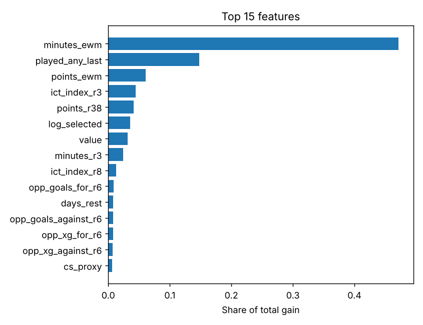

# FPL Points Predictor

A machine-learning pipeline that forecasts **Fantasy Premier League** points for every player in upcoming gameweeks, then uses **integer linear programming** to pick the points-maximising 15-man squad, starting XI and captain under FPL's budget and squad rules.

It's trained on **~167,000 player-match records from 2020-21 to 2026-27**. It was evaluated with walk-forward backtests on three full seasons the model never saw during training. In those tests it beat form-based baselines on every metric, and its picks scored **+11% more points per gameweek** than squads picked by the best of those baselines.



## Results

Walk-forward evaluation: for each test season the model is trained only on earlier seasons, using early stopping on the season just before it. The scores below are averaged over the **2023-24, 2024-25 and 2025-26** test seasons and measured at player-gameweek level (double gameweeks are summed).

| Predictor | MAE ↓ | RMSE ↓ | R² ↑ | Spearman ρ per GW ↑ | Avg pts of top-20 picks ↑ | Optimised squad pts / GW ↑ |
|---|---|---|---|---|---|---|
| **LightGBM model** | **0.984** | **1.931** | **0.336** | **0.706** | **4.88** | **62.4** |
| Form (exp. weighted) | 1.020 | 2.039 | 0.260 | 0.676 | 4.38 | 55.9 |
| Form (last 8 games) | 1.047 | 2.074 | 0.235 | 0.677 | 4.27 | 53.0 |
| Long-run average (38 games) | 1.119 | 2.083 | 0.228 | 0.610 | 4.28 | – |

- The model explains **~30% more variance** (R²) than the strongest baseline, and its errors (RMSE) are **5% lower**.
- It won in **every test season**. Per-season numbers are in [`reports/backtest_summary.csv`](reports/backtest_summary.csv).
- **Squad simulation:** each gameweek the optimiser builds the best legal squad (£100m budget, 2/5/5/3, max 3 players per club) from each predictor's forecasts, and the squad is then scored on the points those players actually got. The model averaged **62.4 pts/GW**, against 55.9 for the best baseline. This is a "free hit every week" setup with no transfer limits, so it measures forecast quality on its own.
- The predictions are **well calibrated**: when the model forecasts 3 points, players score about 3 points on average. See the plot below.

<p float="left">
  
  
</p>

## How it works

```
 vaastav/Fantasy-Premier-League  ──►  data.py      download + clean 7 seasons, link players across seasons
                                      features.py  64 leakage-free features
                                      model.py     LightGBM regressor (expected points per fixture)
                                      evaluate.py  walk-forward backtest, baselines, squad simulation
                                      predict.py   forecast upcoming fixtures, adjust for injury flags
                                      optimize.py  MILP squad / XI / captain selection (SciPy HiGHS)
```

**Features.** Every feature uses only information available before kick-off. All rolling statistics are shifted by one match, and a unit test checks this.
- *Player form:* rolling 3- and 8-match means of points, minutes, xG, xA, xGI, BPS, ICT (influence, creativity, threat), saves, clean sheets and defensive contributions, plus exponentially weighted points and minutes.
- *Playing time / rotation risk:* the share of recent matches with 60+ minutes, whether the player featured last time, and days of rest. Minutes-based features turn out to be the most important ones: in FPL, whether a player plays matters more than anything else.
- *Per-90 rates:* points, xGI, BPS and defensive contributions per 90 minutes.
- *Fixture difficulty:* rolling goals and xG for/against for the player's own team and for the opponent, plus home/away and interaction terms (attacking output × opponent's leakiness, and a clean-sheet proxy).
- *Market signals:* price and ownership.

**Model.** A LightGBM gradient-boosted regressor with an L2 objective, so its predictions estimate *expected* points. The number of boosting rounds is chosen by early stopping on the most recent completed season.

**Squad optimiser.** A mixed-integer linear program over binary squad, starter and captain variables. It maximises XI points plus captain points (and a small weight on bench points), subject to budget, position quotas, valid formations and the 3-players-per-club limit.

## Usage

```bash
pip install -r requirements.txt

# Reproduce the backtest (downloads ~40 MB of data on first run, cached in data/)
python -m fpl_predictor backtest                      # default: 2023-24, 2024-25, 2025-26

# Train the production model on all data, then forecast
python -m fpl_predictor train
python -m fpl_predictor predict --horizon 3 --squad   # next 3 GWs + optimal squad

# Tests
pytest
```

Example output (GW7, 2026-27):

```
=== GW7: top 5 predicted players ===
      name       team position  value        opponents  xpts
   Haaland   Man City      FWD   15.7 Ipswich Town (H) 10.32
    Barnes  Newcastle      MID    6.1  Aston Villa (H)  6.33
João Pedro    Chelsea      FWD    7.8      Everton (A)  6.26
```

Use `--refresh` to pull the latest gameweek data.

## Limitations and next steps

- **FPL's own `xP` column isn't used as a baseline.** In the archived data it correlates about 0.66 with actual points in 2020–25, far higher than any genuine pre-match forecast could. That suggests it was captured *after* the gameweek, so comparing against it wouldn't be fair.
- Players are linked across seasons by full name. This is reliable in practice but not perfect.
- The squad simulation ignores transfers and auto-substitutions. A natural extension is a multi-gameweek transfer planner that accounts for the −4 point hit per extra transfer.
- Possible improvements: bookmaker odds (clean-sheet and anytime-scorer probabilities), confirmed line-ups, and separate models for minutes and for points-given-minutes.

## Data

Historical gameweek data comes from [vaastav/Fantasy-Premier-League](https://github.com/vaastav/Fantasy-Premier-League), a public archive of the official FPL API.
